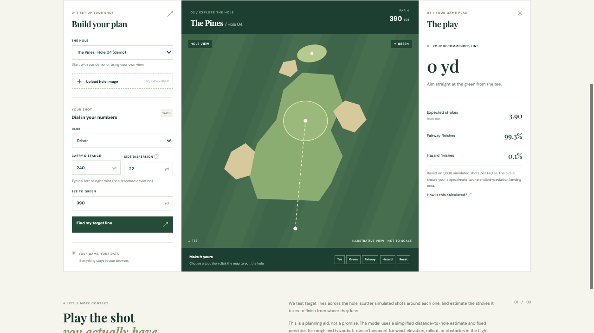

# Fairway

A browser-based golf target planner. Choose the demo hole or upload an overhead image, map its fairway and hazards, enter your carry and lateral dispersion, and compare simulated target lines.

## Screenshots

The planner starts with a demo hole and lets you enter your own shot data.

After simulation, the map shows the recommended line and landing area alongside estimated outcomes.

## Run locally

Open `index.html` in a modern browser, or serve the folder with `python3 -m http.server` and visit `http://localhost:8000`. No build step, account, or backend is required. Uploaded images stay in the browser and are lost on refresh.

## Map your own hole

Upload an overhead image with the tee toward the bottom and green toward the top. Place the tee and green, then select Fairway or Hazard and click at least three points around each area; choose **Finish shape** to save it. Repeat for additional areas. Reset clears the custom map while keeping the image. The image is stretched to fit the map, so use an approximately square crop for best results.

## Model and limitations

The planner tests target offsets from 80 yards left to 80 yards right in 2-yard increments. For each, it simulates 1,000 shots using normally distributed lateral misses (the input is one standard deviation) and a longitudinal standard deviation of 6% of carry. It uses the same random samples for each candidate. The tee-to-green distance calibrates the image, assuming equal map scale in both dimensions. A shot costs one stroke; the remaining-stroke estimate is `2 + distance to green / 170`, with a 0.3-stroke rough surcharge or a 1-stroke hazard surcharge. Shots within 12 yards of the green use two remaining strokes. Hazards take precedence over fairway. This simplified model is illustrative, not a calibrated strokes-gained model; it omits wind, elevation, rollout, flight-path obstacles, and recovery geometry. Results will vary between runs. The displayed landing circle is an approximate two-standard-deviation lateral radius, not a precise probability contour.

The demo hole is illustrative and is not a real course. Users must map areas themselves; the app does not infer them from an image.
